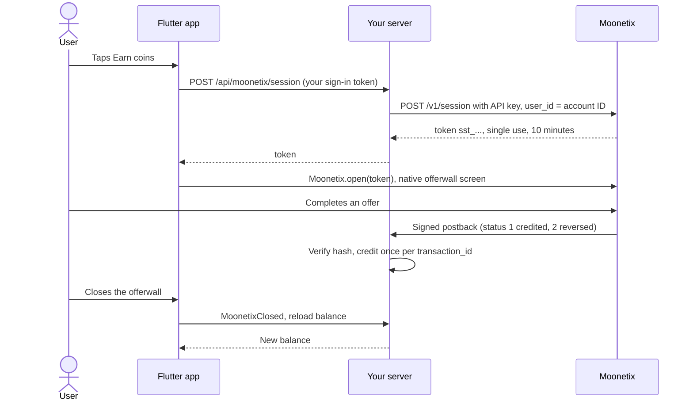

# Flutter Offerwall Example

**A complete Flutter app that opens the Moonetix offerwall in a native screen, with a small server that creates sessions and credits rewards from verified postbacks.**

[](https://github.com/moonetix/offerwall-flutter-example/actions/workflows/ci.yml)
[](LICENSE)
[](https://docs.moonetix.com/flutter-sdk)
[](https://moonetix.com/register?from=github-offerwall-flutter-example)
[](https://moonetix.com/integrations/flutter)
[](https://moonetix.com/academy/integrations/flutter-offerwall)
[](https://moonetix.com/industries/apps)

An Android and iOS app built with the [Moonetix](https://moonetix.com) `moonetix_offerwall` plugin, plus a Node.js server in `server/`. Moonetix is an affiliate network: your users earn your own currency by completing offers, and you earn per completed offer. The app holds no key. Your server creates a single-use session for the signed-in user, and only your server changes balances.

> **Get your App ID and keys: sign up free at https://moonetix.com/register?from=github-offerwall-flutter-example**

## What it covers

1. **The documented integration, wired end to end.** Sign-in, balance, an Earn button that fetches a fresh token on every tap, `Moonetix.open(token)`, and a balance reload on `MoonetixClosed`. The plugin calls match the [Flutter SDK docs](https://docs.moonetix.com/flutter-sdk) line for line.
2. **No secret in the build.** The API key and the postback secret key live only in `server/.env`. The user ID sent to Moonetix is the account ID from your database, never a value the app chooses.
3. **Tested against real Moonetix postbacks.** The server replays credits, retries, decimal rewards, reversals and tampered postbacks produced by the Moonetix signing code, and the Flutter tests drive the screens with a fake native SDK.

## How it fits together



## Quick start

You need Flutter 3.27 or later, Node.js 22.13 or later, an Android emulator or device (Android 5.0+) or an iPhone or iOS Simulator (iOS 13+, Xcode 16+), and an approved Moonetix app.

**1. Start the server**

```bash
git clone https://github.com/moonetix/offerwall-flutter-example.git
cd offerwall-flutter-example/server
cp .env.example .env      # paste your API key and postback secret key
npm start                 # http://127.0.0.1:3000
```

**2. Run the app** (in a second terminal, from the repository root)

```bash
cp config.example.json config.json   # paste your App ID
flutter pub get
flutter run --dart-define-from-file=config.json
```

`API_BASE_URL` in `config.json` is your server. `http://10.0.2.2:3000` reaches your computer from the Android emulator. On the iOS Simulator use `http://localhost:3000`. On a phone, set `HOST=0.0.0.0` in `server/.env` and use your computer's LAN address, or put the server on a public https host. Plain http works only in debug builds on Android and for local addresses on iOS.

**3. Connect Moonetix** in your dashboard:

1. Copy the App ID from the top of your offerwall's settings page into `config.json`.
2. Copy the API key from the API page into `server/.env` as `MOONETIX_API_KEY`.
3. On the Postback page, copy the postback secret key into `server/.env` as `MOONETIX_POSTBACK_KEY`, and save this postback URL:

```
https://YOUR_HOST/moonetix/postback?user={user_id}&tx={transaction_id}&event={event_id}&status={status}&reward={reward}&payout={payout}&offer={offer_name}&hash={hash}
```

| Setting | Where | Default | What it is |
| --- | --- | --- | --- |
| `MOONETIX_APP_ID` | `config.json` (app) | none, required | App ID, 24 lowercase hex characters. Public. |
| `API_BASE_URL` | `config.json` (app) | `http://10.0.2.2:3000` | Your server. Use https in production. |
| `MOONETIX_API_KEY` | `server/.env` | none, required | API key for `POST /v1/session`. Server only. |
| `MOONETIX_POSTBACK_KEY` | `server/.env` | none, required | Postback secret key. Server only. |
| `PORT` | `server/.env` | `3000` | HTTP port |
| `HOST` | `server/.env` | `127.0.0.1` | Bind address. `0.0.0.0` to reach the server from a phone. |
| `DATABASE_PATH` | `server/.env` | `./data.sqlite` | SQLite file for accounts, sign-in tokens and transactions |
| `CURRENCY_NAME` | `server/.env` | `Coins` | Currency label in `/api/me` |
| `SESSION_DAYS` | `server/.env` | `30` | How long a sign-in token stays valid |

The plugin comes from the Moonetix package repository, exactly as the docs show:

```yaml
dependencies:
  moonetix_offerwall:
    hosted: https://moonetix.com/pub
    version: ^2.0.1
```

It brings the Android SDK, the Moonetix Maven repository, its R8 rules and the iOS SDK with it. After adding it to your own app, stop the app and build it again: hot reload does not add native code.

## How it works

1. `main()` calls `Moonetix.init` with the App ID before `runApp`.
2. The user signs in or creates an account on your server (`POST /api/register`, `POST /api/login`). Creating an account needs the "I am 16 or older" box. The server stores a scrypt password hash and only the SHA-256 of each sign-in token.
3. The home screen loads the balance and recent rewards from `GET /api/me`.
4. When the user taps Earn coins, the app calls `POST /api/moonetix/session` with its sign-in token. The server looks up the account and calls `POST https://api.moonetix.com/v1/session` with the API key and that account's ID as `user_id`. Any user ID in the request body is ignored.
5. The server returns only the `token`. On 403 (`app_not_live`, `user_blocked`) it answers 403, on anything else 503, and the app shows "The offerwall is not available right now."
6. The app calls `Moonetix.open(token)`. A new token is fetched on every tap, because a token works once and for 10 minutes.
7. Moonetix calls `GET /moonetix/postback`. The server checks the hash first, credits on status 1 once per `transaction_id`, takes back the stored amount on status 2, and answers 200 only after the change is stored.
8. On `MoonetixClosed`, and when the app returns to the foreground, the app reloads the balance. Events only refresh the screen. They never add coins.

| File | Purpose |
| --- | --- |
| `lib/main.dart` | `Moonetix.init` and app start |
| `lib/src/earn_button.dart` | Earn button, event listener, `Moonetix.open` |
| `lib/src/earn_api.dart` | Calls to your server: sign-in, balance, token |
| `lib/src/home_screen.dart`, `sign_in_screen.dart` | Screens |
| `server/src/server.js` | HTTP routes |
| `server/src/moonetix.js` | `POST /v1/session` call, postback hash, amounts |
| `server/src/postback.js`, `store.js` | Postback handling and SQLite storage (`node:sqlite`) |

## Security notes

- The API key and the postback secret key are read from environment variables on the server. Never put them in the app, `config.json`, or Git. Anyone can read strings out of a compiled app.
- The App ID is public. It is not the API key, and passing the API key to `Moonetix.init` gives `invalidAppId`.
- The session endpoint creates a token only for the account of the sign-in token. The user ID never comes from the app.
- The postback hash is checked with `crypto.timingSafeEqual` before anything else. Tampered or wrongly signed postbacks get 403.
- `transaction_id` is the primary key of the transactions table, so a retry cannot credit twice. Credit and balance change run in one database transaction.
- A reversal subtracts the stored credited amount, only for a transaction credited to the same account. Balances can go below zero after a reversal; say in your terms that rewards can be taken back.
- `payout`, `offer` and `event` are not signed. They are used for display and logs, never for money.
- Amounts are stored as integers in millionths of a coin, so decimal rewards add up exactly.
- Sign-in and sign-up are rate limited per address. The sign-in token is kept in memory in this example; use the Keychain or Keystore (for example through a secure storage package) if you keep users signed in.
- Reward users only for completed offers. Never reward ratings, reviews, installs of your own app, invites or other engagement. Users must be 16 or older.
- Keep the offerwall optional. Never put it in front of your app's core features, and keep it out of apps for children.
- Declare the data the offerwall collects in App Store Connect and in Google Play's Data safety form. The list is in the [Flutter SDK docs](https://docs.moonetix.com/flutter-sdk).

## Test it

**Server**

```bash
cd server
npm test
```

The tests need no network and no Moonetix account. They create accounts, check that sign-in tokens and not client-sent user IDs decide who gets a session, check the exact `POST /v1/session` request against a local stand-in for Moonetix, and replay postbacks produced by the Moonetix signing code with test keys (`server/test/fixtures/moonetix-vectors.json`): credit, retry, decimal rewards, another user's credit, reversal, repeated reversal, reversal of a never-credited `test_` transaction, unknown users, and tampered or wrongly signed postbacks.

To check the running server from the outside, create an account in the app and run [postback-tester](https://github.com/moonetix/postback-tester). It signs postbacks the way Moonetix does and sends a credit and its retry, three kinds of reversal, four forged or unsigned postbacks and five parallel copies of one credit:

```bash
export MOONETIX_POSTBACK_KEY=your-postback-secret-key   # same value as in server/.env
npx github:moonetix/postback-tester --preset moonetix \
  'http://127.0.0.1:3000/moonetix/postback?user={user_id}&tx={transaction_id}&event={event_id}&status={status}&reward={reward}&payout={payout}&offer={offer_name}&hash={hash}' --user 1
```

**App**

```bash
flutter analyze
flutter test
```

The widget tests replace the native SDK with a fake `MoonetixPlatform` and your server with a mock HTTP client. They check that Earn fetches a new token on every tap, that the token reaches `Moonetix.open`, that `MoonetixClosed` reloads the balance, and that server and plugin errors show a message.

**With Moonetix**

1. Run the app on an Android phone, an iPhone, or the iOS Simulator, and create a test account. It gets user ID `1` on a fresh database.
2. Tap Earn coins. The offerwall opens in a native screen. Check that an offer opens in the store or the browser, and that back and close return to the app.
3. In the dashboard, open Offerwalls, your offerwall, Integration, and click **Send a test postback** with user ID `1` and status 1. You can also send one from the Postback page. Close the offerwall or pull to refresh: the balance goes up once.
4. A status 2 test uses a new `test_` transaction ID that was never credited, so the server answers 200 and changes nothing. Every attempt is listed under Reports, Postbacks.
5. Test from a normal home or mobile connection. On a VPN or a cloud test device the offerwall shows a block page such as VPN detected.
6. Remove test rewards from your test accounts before launch.

## Troubleshooting

| What you see | Cause |
| --- | --- |
| `Missing environment variables: ...` when the server starts | `server/.env` is missing or a required key is empty. |
| Sign-in fails with a connection error | `API_BASE_URL` does not reach the server from this device. Emulator: `10.0.2.2`. Simulator: `localhost`. Phone: `HOST=0.0.0.0` and your LAN address. Release builds refuse plain http. |
| "The offerwall is not available right now." and the server logs `moonetix session failed {"status":401,"error":"invalid_api_key"}` | `MOONETIX_API_KEY` is wrong. Every Moonetix failure except 403 reaches the app as 503 `offerwall_unavailable`. |
| Same message, server logs status 403 | `app_not_live` (app paused or not approved yet) or `user_blocked`. Do not retry. |
| Log shows `invalidAppId` | `MOONETIX_APP_ID` in `config.json` is not the 24-character App ID, or the app was started without `--dart-define-from-file=config.json`. |
| Postback answers 403 `invalid hash` | `MOONETIX_POSTBACK_KEY` does not match the Postback page. |

## Learn more

- Docs: [Flutter SDK](https://docs.moonetix.com/flutter-sdk), [Postbacks](https://docs.moonetix.com/postbacks), [Credits and reversals](https://docs.moonetix.com/credits-and-reversals), [Testing](https://docs.moonetix.com/testing)
- Guide: [How to Add an Offerwall to a Flutter App](https://moonetix.com/academy/integrations/flutter-offerwall)
- Guide: [Offerwall postback in Node.js](https://moonetix.com/academy/integrations/offerwall-postback-nodejs)
- Guide: [Test your app before launch](https://moonetix.com/academy/integrations/test-your-app-before-launch)
- Moonetix for Flutter: [moonetix.com/integrations/flutter](https://moonetix.com/integrations/flutter)
- Moonetix for apps: [moonetix.com/industries/apps](https://moonetix.com/industries/apps)

## Get started

**Get your App ID and keys: sign up free at https://moonetix.com/register?from=github-offerwall-flutter-example**

Every publisher application is reviewed by hand. Once you are approved, add your app, set your currency name and rate, and paste the keys into `config.json` and `server/.env`.

## More Moonetix examples

**Start here**
- [awesome-offerwalls](https://github.com/moonetix/awesome-offerwalls): curated guides, tools and examples for offerwall publishers
- [offerwall-postback-handlers](https://github.com/moonetix/offerwall-postback-handlers): tested postback handlers in PHP, Node.js, Python and Java

**SDKs**
- [moonetix-android-sdk](https://github.com/moonetix/moonetix-android-sdk), [moonetix-ios-sdk](https://github.com/moonetix/moonetix-ios-sdk), [moonetix-flutter](https://github.com/moonetix/moonetix-flutter), [moonetix-react-native](https://github.com/moonetix/moonetix-react-native), [moonetix-unity](https://github.com/moonetix/moonetix-unity)

**Web frameworks and backends**
- [offerwall-nextjs-starter](https://github.com/moonetix/offerwall-nextjs-starter), [offerwall-react-vite](https://github.com/moonetix/offerwall-react-vite), [offerwall-vue-nuxt](https://github.com/moonetix/offerwall-vue-nuxt), [offerwall-express](https://github.com/moonetix/offerwall-express), [offerwall-laravel](https://github.com/moonetix/offerwall-laravel), [offerwall-django](https://github.com/moonetix/offerwall-django)
- [offerwall-firebase-functions](https://github.com/moonetix/offerwall-firebase-functions), [offerwall-supabase](https://github.com/moonetix/offerwall-supabase), [rewards-site-starter](https://github.com/moonetix/rewards-site-starter), [moonetix-offerwall-wordpress](https://github.com/moonetix/moonetix-offerwall-wordpress)

**Apps, games and communities**
- [offerwall-react-native-example](https://github.com/moonetix/offerwall-react-native-example), [offerwall-chrome-extension](https://github.com/moonetix/offerwall-chrome-extension), [offerwall-electron](https://github.com/moonetix/offerwall-electron)
- [offerwall-unity-example](https://github.com/moonetix/offerwall-unity-example), [offerwall-godot](https://github.com/moonetix/offerwall-godot), [offerwall-html5-game](https://github.com/moonetix/offerwall-html5-game)
- [telegram-mini-app-offerwall](https://github.com/moonetix/telegram-mini-app-offerwall), [discord-rewards-bot](https://github.com/moonetix/discord-rewards-bot)

**Tools and data**
- [postback-tester](https://github.com/moonetix/postback-tester): signed test postbacks that catch double credits, missed reversals and forged requests
- [signup-guard](https://github.com/moonetix/signup-guard), [datacenter-ip-ranges](https://github.com/moonetix/datacenter-ip-ranges), [offerwall-fraud-playbook](https://github.com/moonetix/offerwall-fraud-playbook): fake sign-ups, datacenter traffic and reward fraud
- [reward-economy-kit](https://github.com/moonetix/reward-economy-kit), [referral-engine](https://github.com/moonetix/referral-engine), [gamification-kit](https://github.com/moonetix/gamification-kit): points math, referrals and retention
- [affiliate-postback-macros](https://github.com/moonetix/affiliate-postback-macros), [country-tiers](https://github.com/moonetix/country-tiers): postback formats of other networks and country tiers for targeting

## License

MIT. See [LICENSE](LICENSE). The `moonetix_offerwall` plugin is licensed separately under the Apache License 2.0.
